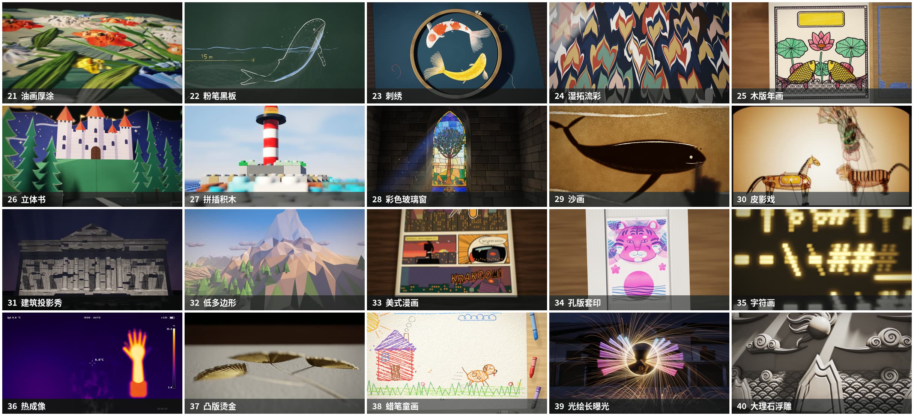

# 新风格 20 种 · 说一句话就出片


## 3 步用起来

1. **下载**：点这个页面上绿色的 **Code** 按钮 → **Download ZIP**，下载后右键 → **全部解压**。
2. **双击安装**：Windows 双击 **`安装-Windows.bat`**（Mac 双击 `安装-Mac.command`，**Mac 版未实测**，见下面说明）。它会自动装好需要的东西，第一次大约 5–20 分钟，看网速。装过的会跳过，可以反复双击。如果弹出蓝色的“Windows 已保护你的电脑”或安全警告，点 **更多信息 → 仍要运行**（文件是从网上下载的，Windows 都会这样问一句）。
3. **说一句话**：打开 [Claude Code](https://claude.com/claude-code)（**装之前就开着的话，先关掉再打开一次**，它才能看到新装的说明），直接说：
   - 「帮我把字符画那条做出来」
   - 「20 种全部渲染」
   - 「把彩色玻璃窗改成偏蓝的晨光」

   AI 会自己找到这个包、出片，告诉你片子放在哪（包里的 `out` 文件夹）。

> **不想等渲染？** 20 条做好的成片可以直接下载：页面右边 **Releases** → `new-styles-20.zip`（约 480 MB，解压后是 `21-油画厚涂.mp4` … `40-大理石浮雕.mp4`）。

---

20 种手艺和媒材，每条 10 秒纯画面（1920×1080，30fps，带配乐音效，**画面里没有文字和署名，拿去就能用**）。没有用任何视频素材、模板或版权音乐：每一帧都由代码算出来，配乐和音效也由代码合成。



| 编号 | 风格 | 画面 |
|---|---|---|
| 21 | **油画厚涂** OIL IMPASTO | 刮刀把油彩一层层堆上画布，堆出一瓶野花，镜头贴着笔触掠过。 |
| 22 | **粉笔黑板** CHALKBOARD | 粉笔在墨绿黑板上画出跃出水面的鲸，板擦擦掉再补一条鲸尾。 |
| 23 | **刺绣** EMBROIDERY | 真丝线一针针顺着针法反光，拉远是整只竹绷，金线在双鱼间盘出珠子。 |
| 24 | **湿拓流彩** PAPER MARBLING | 颜料滴在水面扩成圆圈，梳子拉出羽毛纹，铺纸一揭花纹就印下来。 |
| 25 | **木版年画** WOODBLOCK PRINT | 木版先印黑色线稿，每一拍套一种颜色，莲花鲤鱼一层层活起来。 |
| 26 | **立体书** POP-UP BOOK | 台灯下翻开绘本，森林和城堡一层层立起来，拉一下纸条月亮升起。 |
| 27 | **拼插积木** TOY BRICKS | 积木一块块落下扣上，在蓝色底板上拼出灯塔，微距焦点前后切换。 |
| 28 | **彩色玻璃窗** STAINED GLASS | 昏暗石屋里太阳升起，彩色玻璃一块块透亮，光斑慢慢爬过地面。 |
| 29 | **沙画** SAND ANIMATION | 灯箱上的细沙被手指刮出海浪，一抹变成鲸鱼，又变成月下驼队。 |
| 30 | **皮影戏** SHADOW PUPPETRY | 灯在幕后，牛皮刻的武将骑马登场，和老虎对打。 |
| 31 | **建筑投影秀** PROJECTION MAPPING | 夜里把光投到古典立面上，柱子化成流水，整面墙碎成方块又拼回。 |
| 32 | **低多边形** LOW POLY | 镜头飞过切面山谷，日出照亮三角面，地面翻起长成雪山和大树。 |
| 33 | **美式漫画** COMIC BOOK | 镜头沿漫画格滑过，拟声字蹦出来，英雄冲破格子跳出纸面。 |
| 34 | **孔版套印** RISOGRAPH | 孔版印刷机先印荧光粉再套一层蓝，两色一叠出现一只老虎。 |
| 35 | **字符画** ASCII ART | 琥珀色老显示器上字符像雨一样落下，拼成转动的地球。 |
| 36 | **热成像** THERMAL CAMERA | 热像仪里热水倒进冷杯冒热气，手按玻璃留下发亮的手印。 |
| 37 | **凸版烫金** LETTERPRESS & FOIL | 印版隔着金箔压进厚棉纸，揭开箔膜，压痕里是一枝发亮的银杏。 |
| 38 | **蜡笔童画** CRAYON KIDS | 蜡笔涂出太阳、房子和小狗，每秒重画 12 张，小狗抖着线条跑起来。 |
| 39 | **光绘长曝光** LIGHT PAINTING | 光棒在夜里的老街上画出翅膀，钢丝棉甩出一圈火花，快门一关定格。 |
| 40 | **大理石浮雕** MARBLE RELIEF | 黑暗里一束侧光扫过大理石板，云纹和火焰珠浮出来。 |

作者：**肖雄 / XIAOXIONG** · 开源协议 MIT（可以免费用、改、商用；转载或二次分发代码请保留作者署名）

## 要等多久

| 风格 | 有显卡 | 没有显卡：正式片 | 没有显卡：草稿 |
|---|---|---|---|
| 21 油画厚涂 | 约 7 分钟 | 约 17 小时 | 约 25 分钟 |
| 22 粉笔黑板 | 约 6 分钟 | 约 40 分钟 | 约 3 分钟 |
| 23 刺绣 | 约 6 分钟 | 约 10 小时 | 约 20 分钟 |
| 24 湿拓流彩 | 约 9 分钟 | 约 36 小时 | 约 45 分钟 |
| 25 木版年画 | 约 13 分钟 | 约 10 小时 | 约 6 分钟 |
| 26 立体书 | 约 8 分钟 | 约 8 小时 | 约 9 分钟 |
| 27 拼插积木 | 约 8 分钟 | 约 10 小时 | 约 15 分钟 |
| 28 彩色玻璃窗 | 约 4 分钟 | 约 5.5 小时 | 约 15 分钟 |
| 29 沙画 | 约 6 分钟 | 约 2 小时 | 约 5 分钟 |
| 30 皮影戏 | 约 10 分钟 | 约 3.5 小时 | 约 5 分钟 |
| 31 建筑投影秀 | 约 7 分钟 | 约 14 小时 | 约 20 分钟 |
| 32 低多边形 | 约 4 分钟 | 约 1.5 小时 | 约 3 分钟 |
| 33 美式漫画 | 约 10 分钟 | 约 50 分钟 | 约 4 分钟 |
| 34 孔版套印 | 约 5 分钟 | 约 2 小时 | 约 4 分钟 |
| 35 字符画 | 约 7 分钟 | 约 2 小时 | 约 3 分钟 |
| 36 热成像 | 约 4 分钟 | 约 30 分钟 | 约 2 分钟 |
| 37 凸版烫金 | 约 9 分钟 | 约 7 小时 | 约 9 分钟 |
| 38 蜡笔童画 | 约 4 分钟 | 约 1.5 小时 | 约 4 分钟 |
| 39 光绘长曝光 | 约 4 分钟 | 约 40 分钟 | 约 2 分钟 |
| 40 大理石浮雕 | 约 6 分钟 | 约 12 小时 | 约 25 分钟 |
| **20 条全部** | **约 2.3 小时** | **约 145 小时** | |

“有显卡”是在 RTX 4060 Ti 台式机上实测 / 估算的；“没有显卡”是 12 线程 CPU 用软件渲染估算的，草稿 = 半分辨率、不加运动模糊。

**没有独立显卡的电脑**：能出片，但正式片一条要半小时到一天多，所以 make.js 不会自己开始，会先提示你。建议直接去 Releases 下载做好的成片；改过的风格先出草稿（`--draft`）看效果，满意了再挑着出正式片（`--cpu`，可以过夜跑，中断了能接着做）。核显、笔记本显卡介于两者之间、差别很大，以出片时显示的“预计还要”为准。

- 第一次出片前，AI 会先告诉你大概要多久。中途关掉也没关系，再说一次「继续做」（或再运行同一条命令）会从停下的地方接着做。
- 想先看效果：说「先给我看一张字符画第 5 秒的图」，几秒到一分钟就出来。

## 电脑要求

| 项目 | 要求 |
|---|---|
| 系统 | Windows 10 / 11（64 位）。Mac 版安装脚本已写好但**作者没有实测**。 |
| 硬盘 | 装好约 2 GB（浏览器、Python、ffmpeg 等）；出片时每条临时占几百 MB，做完自动删掉；20 条成片一共约 480 MB。 |
| 显卡 | 最好有独立显卡（N 卡 / A 卡）：一条几分钟。没有也能出图、出草稿，但正式片一条要半小时到一天多（见上表），不想等就直接下载成片。 |
| 网络 | 第一次安装要下载约 0.5–1 GB（浏览器、ffmpeg 等；已经装过的不再下载）。渲染组件、浏览器、numpy 下载失败时会自动换国内镜像再试一次。 |
| AI 助手 | 主要按 Claude Code 写的说明书；Codex、Cursor 等能读 `AGENTS.md` 的助手也可以，在这个文件夹里打开它们就行。 |

## 常见问题

**双击 `安装-Windows.bat` 一闪就没了 / 提示要和整个包放在一起？**
先把下载的 zip「全部解压」，再进解压出来的文件夹双击。不要在压缩包里直接双击。

**双击后弹出“无法验证发布者”或蓝色的“Windows 已保护你的电脑”？**
因为文件是从网上下载的。蓝色窗口点 **更多信息 → 仍要运行**；小的安全警告窗口点“运行”。

**安装时弹出“是否允许此应用更改设备”？**
那是在装 Node.js，点“是”。

**装完了，Claude Code 却好像不知道这个包？**
把 Claude Code 完全关掉再打开（装之前开着的窗口看不到新装的说明）。还不行就再双击一次安装文件。

**装完说找不到 ffmpeg / Python？**
关掉所有终端窗口和 Claude Code，重新打开再试。还不行就再双击一次安装文件。

**Mac 双击 `安装-Mac.command` 提示“无法打开”？**
在访达里按住 control 点它 → 打开 → 再点“打开”。或者打开“终端”，输入 `bash `（后面有个空格），把文件拖进去，回车。Mac 上要先装 Homebrew（脚本会告诉你怎么装，这一步要输开机密码，得你自己来）。

**AI 说“没检测到能用的显卡”或“显卡渲染没成功”？**
没显卡时正式片一条要等半小时到一天多，所以它会先停下来问你：直接下载做好的成片、先出草稿看效果，还是过夜慢慢渲。选一个告诉它就行。显卡接口偶尔出问题时，它会自己换一种接口重试。

**片子在哪？**
包里的 `out` 文件夹，文件名是「编号-中文名.mp4」，比如 `out/35-字符画.mp4`。

**能改成我想要的样子吗？**
能。直接跟 AI 说，比如「把蜡笔童画里的小狗换成小猫」「沙画的节奏慢一点」。AI 会先把原版备份一份（`index.原版.html`），改好后出几张图给你看，你满意了再出正式片。改坏了说一句「换回原版」就行。

**不用 AI，自己敲命令行不行？**
行。在这个文件夹里打开终端：

```
node make.js check          检查装齐没有
node make.js list           20 种的编号和名字
node make.js still 35 5     出一张图（35 号第 5 秒）
node make.js style 35       出 10 秒成片 → out/35-字符画.mp4
node make.js style all      20 种全部出片
```

**硬盘满了？**
`node make.js clean` 删掉没做完的临时帧；成片不受影响。

## 文件夹里都是什么

```
安装-Windows.bat / 安装-Mac.command   一键安装
make.js        唯一入口：检查、出图、出片（所有提示都是中文）
render.js      逐帧渲染器：无头浏览器一帧一帧截图，多张子帧叠出运动模糊；字体、显卡都内置处理
styles/        20 个风格：每个一个 index.html（画面）+ music.py（配乐音效）+ render.args（渲染参数）
lib/           画面公共库（时间轴、WebGL、光线步进 3D、连续镜头、笔触）
audio/         配乐音效合成（Python）
fonts/         渲染用的字体和许可证（不装进系统）
skills/        给 AI 看的说明书（安装时会装到 Claude Code 里）
AGENTS.md      给 Codex / Cursor 等 AI 看的说明
```

## 致谢

字体：思源黑体 Noto Sans CJK SC（Adobe / Google，OFL）、Inter（OFL）、DejaVu Sans Mono、TeX Gyre Heros Cn（GUST 字体协议），许可证见 [fonts/LICENSES.md](fonts/LICENSES.md)。渲染用 [Playwright](https://playwright.dev) + Chromium，视频合成用 [FFmpeg](https://ffmpeg.org)。

欢迎关注作者 **肖雄 XIAOXIONG**，分享你用它做出来的作品。
